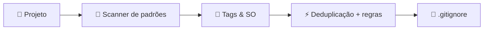

<div align="center">

```
  ________.__
 /  _____/|__| ____   ____
/   \  ___|  |/ ___\ /    \
\    \_\  \  / /_/  >   |  \
 \______  /__\___  /|___|  /
        \/  /_____/      \/
```

# gign

### ⚡ Gerador inteligente, offline e automático de `.gitignore` para qualquer projeto

[](https://www.npmjs.com/package/gign)
[](https://www.npmjs.com/package/gign)
[](https://github.com/juninmd/gign/releases)
[](https://nodejs.org/)
[](LICENSE)
[](https://codecov.io/gh/juninmd/gign)

<p>
  <a href="#-recursos">Recursos</a> •
  <a href="#-instalação">Instalação</a> •
  <a href="#-uso">Uso</a> •
  <a href="#-como-funciona">Como funciona</a> •
  <a href="#-stacks-suportadas">Stacks</a> •
  <a href="#-automação--deploy">Deploy</a> •
  <a href="#-desenvolvimento">Desenvolvimento</a> •
  <a href="#-licença">Licença</a>
</p>

</div>

---

## 💡 O que é o gign?

O **gign** inspeciona a estrutura do seu projeto, detecta o sistema operacional e todas as linguagens, frameworks e ferramentas em uso (Node.js, TypeScript, Python, Docker, Rust, Go, VS Code, JetBrains, e muito mais) e gera um `.gitignore` sob medida, **deduplicado** e **100% offline**, sem chamadas a APIs externas.

Inspirado pelo clássico [gitignore.io](https://www.toptal.com/developers/gitignore), mas totalmente autocontido.

---

## ✨ Recursos

|     | Recurso                         | Descrição                                                                                                                   |
| --- | ------------------------------- | --------------------------------------------------------------------------------------------------------------------------- |
| 🚀  | **Offline e instantâneo**       | Templates oficiais de [`github/gitignore`](https://github.com/github/gitignore) embutidos no pacote. Zero chamadas de rede. |
| 🔍  | **Detecção automática**         | Mapeia arquivos de configuração, lockfiles e diretórios para identificar tecnologias.                                       |
| 🖥️  | **Sensível ao sistema**         | Inclui automaticamente as regras do SO atual (`.DS_Store`, `Thumbs.db`, etc.).                                              |
| 🧹  | **Deduplicação inteligente**    | Mescla múltiplos templates sem repetir regras.                                                                              |
| 📦  | **Sem dependências em runtime** | Distribuído como um único bundle minificado via `esbuild`.                                                                  |
| 🔐  | **Proveniência npm**            | Publicação com assinatura criptográfica via OIDC no GitHub Actions.                                                         |

---

## 🚀 Instalação

### Execução direta (sem instalar)

```bash
npx gign .
```

### Instalação global

```bash
npm install -g gign     # npm
pnpm add -g gign        # pnpm
yarn global add gign    # yarn
bun add -g gign         # bun
```

---

## 📖 Uso

```bash
# No diretório atual
gign .

# Em um diretório específico
gign ./meu-projeto
```

Exemplo de saída:

```text
[gign] generated at /workspace/meu-projeto/.gitignore
[gign] tags: macos,node,react,typescript,visualstudiocode
[gign] manual tags: jest,prettier,typescript,vite
```

O arquivo gerado já vem organizado por seções, pronto para ser versionado. ✅

---

## 🧠 Como funciona



1. **Varredura:** analisa arquivos-chave como `package.json`, `Cargo.toml`, `go.mod` e `requirements.txt`.
2. **Resolução de tags:** identifica o SO host e cruza arquivos e extensões com `pattern.json` e `manual.json`.
3. **Composição:** carrega os templates de `src/data/templates.json`, adiciona as regras manuais e remove duplicatas linha a linha.
4. **Gravação:** salva o `.gitignore` final no diretório alvo.

---

## 🛠️ Stacks suportadas

Mais de **250 ecossistemas** são suportados nativamente.

<details>
<summary><b>Ver as principais tecnologias detectadas</b></summary>

<br>

- **Linguagens:** TypeScript, JavaScript, Python, Go, Rust, Java, Kotlin, C/C++, C#, Ruby, PHP, Swift, Dart, Elixir, Scala, Lua, Zig
- **Frontend & meta-frameworks:** React, Next.js, Vue, Nuxt, Svelte, SvelteKit, Astro, Remix, Angular, Vite, Gatsby
- **Backend & runtimes:** Node.js, Bun, Deno, NestJS, Express, Fastify, Django, Flask, FastAPI, Laravel, Spring Boot
- **Infraestrutura & DevOps:** Docker, Kubernetes, Terraform, Helm, Serverless, AWS CDK, Pulumi, Cloudflare Workers
- **IDEs & editores:** Visual Studio Code, JetBrains (IntelliJ, WebStorm, PyCharm, CLion, Rider, GoLand), Xcode, Sublime Text, Vim
- **Testes & qualidade:** Jest, Vitest, Playwright, Cypress, ESLint, Prettier, Biome, Ruff, Coverage

</details>

---

## 🔄 Automação & deploy

Entregas totalmente automatizadas:

- **Conventional Commits:** `feat:`, `fix:`, `perf:` e `BREAKING CHANGE` definem o bump de versão (minor, patch ou major).
- **semantic-release:** analisa os commits, calcula a próxima versão e gera tags e notas de release, sem aprovação manual.
- **Publicação no npm:** a cada push em `master`, o GitHub Actions valida testes e lint, compila o bundle e publica no [npm](https://www.npmjs.com/package/gign) com **proveniência**.

---

## 💻 Desenvolvimento

```bash
git clone https://github.com/juninmd/gign.git
cd gign
npm ci

npm test                  # suíte de testes (Jest)
npm run test:coverage     # testes com cobertura
npm run lint              # ESLint
npm run format            # Prettier (escrita)
npm run format:check      # Prettier (checagem)
npm run build             # bundle de produção em dist/
npm run sync:templates    # atualiza templates a partir de github/gitignore
```

Veja [CONTRIBUTING.md](CONTRIBUTING.md) para as diretrizes de contribuição.

---

## 📄 Licença

Distribuído sob a licença [MIT](LICENSE).

<div align="center">

Feito com ☕ por [Antonio Carlos](https://github.com/juninmd)

</div>
