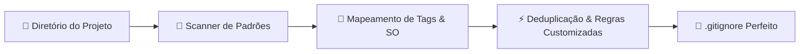

<div align="center">

```
  ________.__
 /  _____/|__| ____   ____
/   \  ___|  |/ ___\ /    \
\    \_\  \  / /_/  >   |  \
 \______  /__\___  /|___|  /
        \/  /_____/      \/
```

# gign

### ⚡ Gerador inteligente, offline e automático de `.gitignore` para qualquer projeto.

[](https://www.npmjs.com/package/gign)
[](https://www.npmjs.com/package/gign)
[](https://github.com/juninmd/gign/releases)
[](https://nodejs.org/)
[](LICENSE)
[](https://codecov.io/gh/juninmd/gign)

<p align="center">
  <a href="#-principais-recursos">Recursos</a> •
  <a href="#-instalação-e-execução">Instalação</a> •
  <a href="#-como-usar">Uso</a> •
  <a href="#-como-funciona">Como Funciona</a> •
  <a href="#-stacks-suportadas">Stacks</a> •
  <a href="#-automação--deploy">CI/CD & Deploy</a> •
  <a href="#-desenvolvimento-local">Desenvolvimento</a> •
  <a href="#-licença">Licença</a>
</p>

---

</div>

## 💡 O que é o gign?

O **gign** inspeciona a estrutura do seu projeto, identifica automaticamente o sistema operacional (Windows, macOS, Linux) e todas as linguagens, frameworks e ferramentas utilizadas (Node.js, TypeScript, Python, Docker, Rust, Go, VS Code, JetBrains, etc.), gerando um arquivo `.gitignore` sob medida, perfeitamente deduplicado e **100% offline** — sem chamadas a APIs externas e com zero latência.

Inspirado pelo clássico [gitignore.io](https://www.toptal.com/developers/gitignore), mas totalmente autocontido e inteligente.

---

## ✨ Principais Recursos

- 🚀 **100% Offline & Instantâneo:** Templates oficiais embutidos localmente via bundle (`github/gitignore`). Zero chamadas de rede.
- 🔍 **Detecção Automática Profunda:** Mapeia arquivos de configuração, locks e diretórios para detectar automaticamente mais de 250 tecnologias.
- 🖥️ **Sensível ao Sistema Operacional:** Inclui automaticamente regras do OS atual (`.DS_Store`, `Thumbs.db`, etc.).
- 🧹 **Deduplicação Inteligente:** Mescla padrões sem repetir regras redundantes entre múltiplos templates.
- 📦 **Zero Dependências em Produção:** Empacotado em um único arquivo minificado com `esbuild`.
- 🔐 **Build com Proveniência npm:** Assinatura criptográfica via OIDC diretamente no GitHub Actions.

---

## 🚀 Instalação e Execução

### Execução Direta (Zero Instalação)

A forma mais rápida de usar é com `npx`:

```bash
npx gign .
```

### Instalação Global

Escolha seu gerenciador de pacotes favorito:

```bash
# npm
npm install -g gign

# pnpm
pnpm add -g gign

# yarn
yarn global add gign

# bun
bun add -g gign
```

---

## 📖 Como Usar

No terminal, informe o caminho do diretório do projeto:

```bash
# No diretório atual:
gign .

# Em um diretório específico:
gign ./meu-projeto
```

### Exemplo de Saída:

```text
[gign] generated at /workspace/meu-projeto/.gitignore
[gign] tags: macos,node,react,typescript,visualstudiocode
[gign] manual tags: jest,prettier,typescript,vite
```

O arquivo `.gitignore` resultante já estará formatado, organizado por seções e pronto para ser versionado!

---

## 🧠 Como Funciona



1. **Varredura:** O `gign` analisa arquivos-chave (e.g. `package.json`, `Cargo.toml`, `go.mod`, `requirements.txt`, etc.).
2. **Resolução de Tags:** Identifica o SO host e cruza as extensões e arquivos encontrados com os dicionários `pattern.json` e `manual.json`.
3. **Composição e Deduplicação:** Carrega os templates correspondentes de `src/data/templates.json`, adiciona as regras manuais e remove duplicatas linha por linha.
4. **Gravação:** Salva o `.gitignore` final diretamente no diretório alvo.

---

## 🛠️ Stacks Suportadas

São mais de 250 ecossistemas suportados nativamente, incluindo:

<details>
<summary><b>Clique para ver as principais tecnologias detectadas</b></summary>

- **Linguagens:** TypeScript, JavaScript, Python, Go, Rust, Java, Kotlin, C/C++, C#, Ruby, PHP, Swift, Dart, Elixir, Scala, Lua, Zig.
- **Frontend & Meta-Frameworks:** React, Next.js, Vue, Nuxt, Svelte, SvelteKit, Astro, Remix, Angular, Vite, Gatsby.
- **Backend & Runtimes:** Node.js, Bun, Deno, NestJS, Express, Fastify, Django, Flask, FastAPI, Laravel, Spring Boot.
- **Infraestrutura & DevOps:** Docker, Kubernetes, Terraform, Helm, Serverless, AWS CDK, Pulumi, Cloudflare Workers.
- **IDEs & Editores:** Visual Studio Code, JetBrains (IntelliJ, WebStorm, PyCharm, CLion, Rider, GoLand), Xcode, Sublime Text, Vim.
- **Ferramentas de Teste & Qualidade:** Jest, Vitest, Playwright, Cypress, ESLint, Prettier, Biome, Ruff, Coverage.

</details>

---

## 🔄 Automação & Deploy

O repositório está configurado para entregas contínuas totalmente automatizadas:

- **Conventional Commits:** Cada commit padronizado (`feat:`, `fix:`, `perf:`, `BREAKING CHANGE`) determina o bump de versão (minor/patch/major).
- **semantic-release:** Analisa os commits, calcula a próxima versão e gera as notas de release e tags sem necessidade de aprovação manual ou PRs intermediários.
- **Publicação Automática no npm:** A cada push no branch `master`, a pipeline do GitHub Actions valida a suíte de testes, roda o lint, compila o bundle e publica automaticamente a nova versão no [npm](https://www.npmjs.com/package/gign) com **proveniência criptográfica**.

---

## 💻 Desenvolvimento Local

```bash
# Clone o repositório
git clone https://github.com/juninmd/gign.git
cd gign

# Instale as dependências
npm ci

# Execute a suíte de testes
npm test

# Testes com relatório de cobertura
npm run test:coverage

# Valide com linter
npm run lint

# Formate o código automaticamente
npm run format

# Verifique a formatação sem alterar arquivos
npm run format:check

# Compile o bundle de produção
npm run build

# Sincronize templates upstream com github/gitignore
npm run sync:templates
```

---

## 📄 Licença

Distribuído sob a licença [MIT](LICENSE). Consulte o arquivo para obter mais detalhes.
